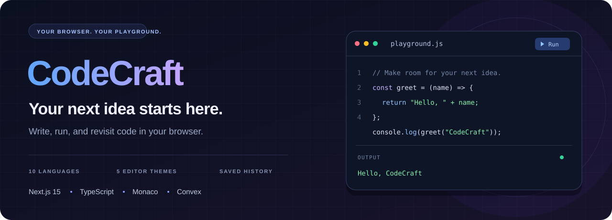

<p align="center">
  
</p>

<p align="center">
  <strong>A browser-based playground for ideas written in code.</strong><br />
  A familiar editor, multiple languages, and your execution history in one workspace.
</p>

<p align="center">
  <a href="https://code-dusky-kappa.vercel.app"><strong>Open CodeCraft ↗</strong></a>
  &nbsp; · &nbsp;
  <a href="#features">Features</a>
  &nbsp; · &nbsp;
  <a href="#getting-started">Getting started</a>
  &nbsp; · &nbsp;
  <a href="https://github.com/aeubs66/code/issues">Feedback</a>
</p>

<p align="center">
  
  
  
  
  <a href="LICENSE"></a>
</p>

---

## Meet CodeCraft

CodeCraft brings a code editor and execution output together in a web application. Choose a language, adjust the workspace to your preferences, and run code through the integrated Piston execution service.

The application combines Monaco Editor with Clerk authentication and a Convex backend for execution history, profile statistics, and snippet data.

## Features

| Your workspace | Your progress |
| :--- | :--- |
| **Monaco Editor** — Syntax highlighting, language-aware editing, and starter examples. | **Execution history** — Save code, output, and errors to revisit from your profile. |
| **10 configured languages** — Switch between scripting and compiled languages. | **Profile statistics** — Review execution totals, language usage, and recent activity. |
| **5 editor themes** — VS Dark, VS Light, GitHub Dark, Monokai, and Solarized Dark. | **Persistent preferences** — Keep language, theme, font size, and drafts in browser storage. |
| **Output panel** — View results and execution errors alongside your code. | **Account access** — Clerk sign-in connects the workspace to stored user data. |

### Languages

**JavaScript · TypeScript · Python · Java · Go · Rust · C++ · C# · Ruby · Swift**

Language configurations and starter programs live in [the editor constants](src/app/%28root%29/_constants/index.ts). Execution depends on the external Piston service and the configured runtime versions.

### Additional foundations

The backend includes snippet creation, stars, and comments, along with Lemon Squeezy purchase webhooks. These are implementation foundations: the current source does not include a public snippet browsing route, and the editor's share button is not connected.

## Tech stack

| Layer | Technologies |
| :--- | :--- |
| Application | Next.js 15 App Router · React 19 release candidate · TypeScript |
| Editing & execution | Monaco Editor · Piston API |
| Backend & data | Convex queries, mutations, and HTTP actions |
| Authentication | Clerk · Svix webhook verification |
| Interface | Tailwind CSS · Framer Motion · Lucide |
| Client state | Zustand · Browser local storage |
| Purchase integration | Lemon Squeezy webhooks |

## Getting started

You will need Node.js compatible with Next.js 15, npm, and your own Clerk and Convex projects.

### 1. Install dependencies

```bash
git clone https://github.com/aeubs66/code.git
cd code
npm ci
```

### 2. Configure local services

Create `.env.local` in the repository root with your own values:

```dotenv
NEXT_PUBLIC_CLERK_PUBLISHABLE_KEY=<your-clerk-publishable-key>
CLERK_SECRET_KEY=<your-clerk-secret-key>
NEXT_PUBLIC_CLERK_AFTER_SIGN_UP_URL=/
NEXT_PUBLIC_CLERK_AFTER_SIGN_IN_URL=/
CONVEX_DEPLOYMENT=<your-convex-deployment>
NEXT_PUBLIC_CONVEX_URL=<your-convex-cloud-url>
```

Run the Convex development process and follow its project setup prompts:

```bash
npx convex dev
```

Keep that process running. Use the deployment and client URL created for **your** project in the local environment file.

### 3. Connect authentication

1. In Clerk, configure a JWT template named `convex` for the Convex integration.
2. Set the provider domain in [`convex/auth.config.ts`](convex/auth.config.ts) to your own Clerk issuer domain. The checked-in value belongs to the original development setup.
3. In your Convex deployment's environment settings, set `CLERK_WEBHOOK_SECRET` to your Clerk endpoint signing secret.
4. Subscribe a Clerk webhook to `user.created`, pointing at your Convex HTTP actions URL followed by `/clerk-webhook`. Use the deployment's `.convex.site` URL for webhooks.
5. Create a fresh test user after the webhook is connected so its account is synced to Convex.

### 4. Start the application

In a second terminal:

```bash
npm run dev
```

Open [localhost:3000](http://localhost:3000) and sign in. The Run Code control is displayed for signed-in users.

<details>
<summary><strong>Purchase integration and current setup notes</strong></summary>

- For Lemon Squeezy testing, set `LEMON_SQUEEZY_WEBHOOK_SECRET` in the Convex deployment and send purchase events to `/lemon-squeezy-webhook` on its HTTP actions URL.
- The checkout link in [`UpgradeButton.tsx`](src/app/pricing/_components/UpgradeButton.tsx) is hardcoded to an existing store. Replace it with your own test checkout before testing purchases.
- New users currently receive `isPro: true` in [`convex/users.ts`](convex/users.ts). Treat the pricing screens as integration scaffolding rather than verified paid-access enforcement.
- Running code sends the entered source to the Piston endpoint configured in [the editor store](src/store/useCodeEditorStore.ts). Avoid entering secrets.
- The setup instructions were checked against the source; a fresh installation and the external service integrations have not been validated as part of this documentation update.

</details>

## Useful commands

| Command | Purpose |
| :--- | :--- |
| `npm run dev` | Start the Next.js development server |
| `npx convex dev` | Develop and sync the Convex backend |
| `npm run build` | Create a production build |
| `npm start` | Serve the production build |
| `npm run lint` | Run the configured Next.js lint checks |

## Explore the source

| Location | Purpose |
| :--- | :--- |
| [`src/app/(root)/`](src/app/%28root%29) | Editor workspace, language and theme selectors, output panel |
| [`src/app/profile/`](src/app/profile) | Execution history and account statistics |
| [`src/app/pricing/`](src/app/pricing) | Pricing interface and checkout link |
| [`src/store/`](src/store) | Editor state, local preferences, and execution requests |
| [`src/components/`](src/components) | Shared navigation, authentication, and providers |
| [`convex/`](convex) | Database schema, backend functions, and webhooks |
| [`public/`](public) | Language icons and static assets |

## Contributing

Found a bug or have an improvement in mind? [Open an issue](https://github.com/aeubs66/code/issues) with reproduction steps or your proposed change. For pull requests, explain what changed and how you checked it; include screenshots for interface changes.

## License & attribution

Distributed under the [MIT License](LICENSE). The existing license credits **Burak (2024)**; its copyright notice is preserved.

---

<p align="center">
  <strong>Write something. Run it. Keep exploring.</strong><br />
  <a href="https://code-dusky-kappa.vercel.app">Open the workspace ↗</a>
</p>
